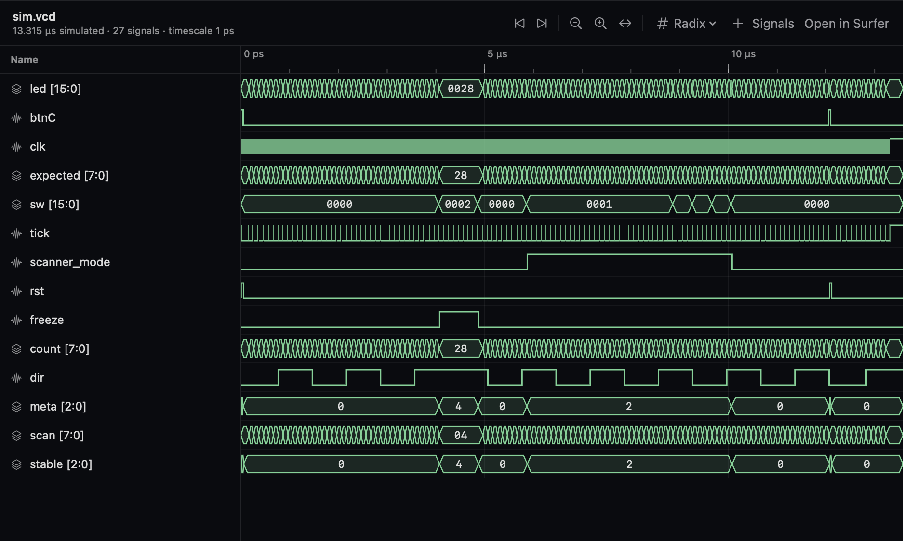
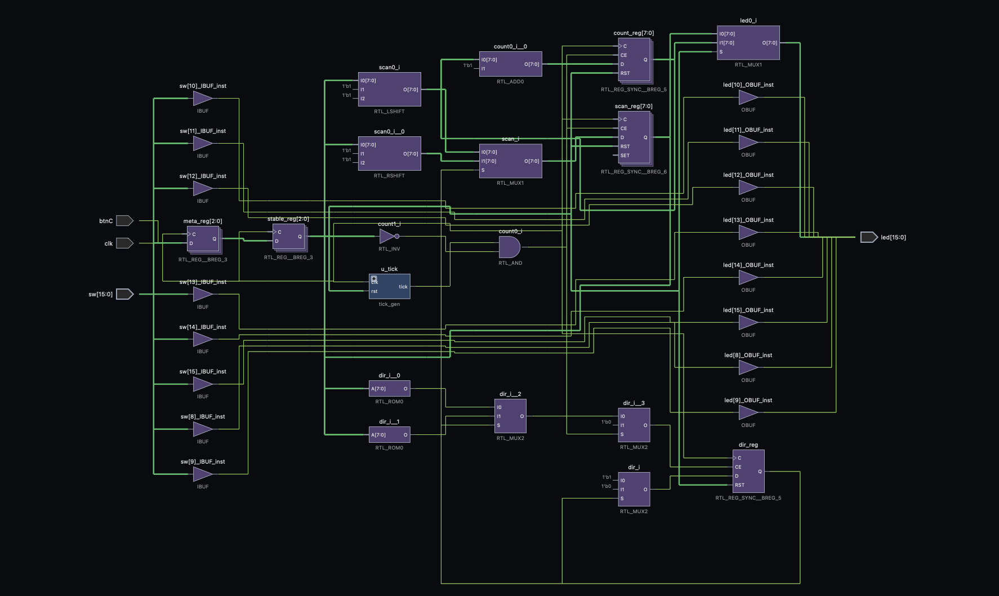
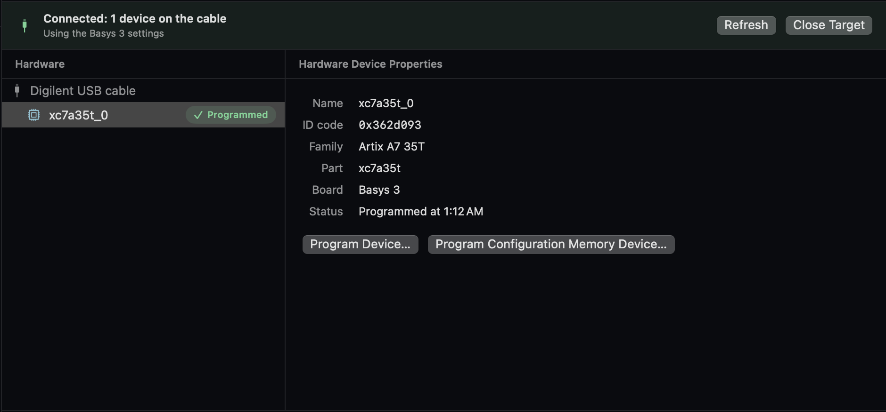

# Getting started

This guide takes you from nothing to a design built by Vivado and running on your board. It covers installing FPGA
Bridge on your Mac, preparing a Windows PC with Vivado to do the builds, connecting the two with Tailscale, and
programming the board.

**Only some of it is needed for what you want to do:**

| You want to | You need |
| --- | --- |
| Write Verilog and run simulations | Part 1 only (just the Mac) |
| Build bitstreams | Parts 1 to 3 (the Mac and a Windows PC with Vivado) |
| Program a board | All four parts, plus the board and a USB cable |

> FPGA Bridge has been tested on real hardware with **one board, the Digilent Basys 3**, using Vivado 2025.2 on
> Windows. Seven more Digilent boards are set up but untested. If you have one, please try it: see
> [Help test other boards](#help-test-other-boards).

**Contents**

1. [The Mac](#part-1-the-mac)
2. [The Windows PC](#part-2-the-windows-pc)
3. [Connect the Mac to the PC](#part-3-connect-the-mac-to-the-pc)
4. [Build and program your first design](#part-4-build-and-program-your-first-design)
- [Using a Linux build machine instead](#using-a-linux-build-machine-instead)
- [Help test other boards](#help-test-other-boards)
- [Troubleshooting](#troubleshooting)
- [Uninstalling](#uninstalling)

## What you need

- **A Mac with Apple silicon** (M1 or later) running **macOS 14 Sonoma or later**. Intel Macs aren't supported yet.
- **A Windows 10 or 11 PC** that can run Vivado, for building. It can be anywhere: Tailscale connects it to your Mac
  over the internet, so it can stay at home while you work elsewhere.
- **A supported FPGA board** and a **USB cable that carries data** (some cables only charge). See
  [boards.md](boards.md).

Vivado never runs on the Mac. Your Mac sends the design files to the PC over SSH, Vivado builds them there, and the
results come back. The board plugs into the Mac.

---

## Part 1: The Mac

### 1.1 Download the app

1. Download **FPGA-Bridge.zip** from the
   [latest release](https://github.com/shaayan-goswami/fpga-bridge/releases/latest).
2. Double-click the zip to unzip it, and drag **FPGA Bridge** into your **Applications** folder.

Later versions: the app checks GitHub once a day and shows a notice when a newer one is out. Download it the same way
and replace the app (then repeat 1.2). Turn the check off in **FPGA Bridge > Settings… > General**.

### 1.2 Allow it to open

The app isn't notarized by Apple yet, so macOS blocks it the first time ("Apple could not verify…"). Open
**Terminal** (in Applications > Utilities) and run:

```sh
xattr -dr com.apple.quarantine "/Applications/FPGA Bridge.app"
```

This removes the "downloaded from the internet" flag from the app and the command-line tool inside it. Then open the
app normally.

Instead of Terminal, you can try to open the app once, then go to **System Settings > Privacy & Security**, scroll
down, and click **Open Anyway** next to the message about FPGA Bridge. Apple explains this in
[Open a Mac app from an unknown developer](https://support.apple.com/guide/mac-help/open-a-mac-app-from-an-unknown-developer-mh40616/mac).
That covers the app only; the `fpga-bridge` command in the next step still needs the `xattr` command above.

### 1.3 Make the `fpga-bridge` command available

Setting up the connection to the PC uses a command-line tool, `fpga-bridge`, which comes inside the app. Make it
available in Terminal:

```sh
sudo mkdir -p /usr/local/bin
sudo ln -sf "/Applications/FPGA Bridge.app/Contents/MacOS/fpga-bridge" /usr/local/bin/fpga-bridge
fpga-bridge --help
```

`sudo` asks for your Mac's login password (nothing appears as you type). The last line should print a list of
commands.

### 1.4 Install Homebrew

[Homebrew](https://brew.sh) installs the open-source tools FPGA Bridge uses. Paste the install command from
[brew.sh](https://brew.sh) into Terminal and follow its prompts. **When it finishes, it prints "Next steps" with
two or three commands: run them**, or the `brew` command won't be found.

Check it worked:

```sh
brew --version
```

### 1.5 Install the simulator and the board programmer

```sh
brew install icarus-verilog openfpgaloader
```

- [Icarus Verilog](https://steveicarus.github.io/iverilog/) runs your testbenches when you click **Run Simulation**.
- [openFPGALoader](https://trabucayre.github.io/openFPGALoader/) programs the board over USB.

Optional: `brew install surfer` adds [Surfer](https://surfer-project.org), an external waveform viewer. The app has
its own, so you don't need it.

### 1.6 Create an SSH key

The PC will recognize your Mac by its SSH key. Check whether you already have one:

```sh
ls ~/.ssh/id_ed25519.pub
```

If that says "No such file or directory", create one (press Return at each question to accept the defaults; a
passphrase is optional):

```sh
ssh-keygen -t ed25519
```

You'll paste this key on the PC in Part 3.

**You can now write and simulate designs.** Open FPGA Bridge, choose **Open Example Project** on the start page, and
click **Run Simulation** in the Flow Navigator on the left. The Vivado steps stay greyed out until Part 3 is done.

---

## Part 2: The Windows PC

### 2.1 Install Vivado

1. Go to AMD's [downloads page](https://www.xilinx.com/support/download.html). You need a free AMD account to download.
2. Download the installer for Windows and run it.
3. Choose **Vivado**, then the free **Standard** edition. It needs no license for the boards FPGA Bridge supports.
4. When asked which devices to install, you can untick everything except **7 Series** (the family of the Basys 3 and
   the other supported boards). This saves a lot of disk space and download time.
5. Leave the install folder as it is. The setup script in Part 3 finds Vivado in the usual places.

The download is large and the install takes a while. Tested with Vivado 2025.2; other versions should work.

You don't need to open Vivado afterwards: FPGA Bridge starts it in the background for each build.

### 2.2 Install Tailscale

[Tailscale](https://tailscale.com) makes a private network between your devices, so your Mac can reach the PC from
anywhere: home, school, a café. No router or firewall changes are needed, and the free personal plan is enough.

1. Download Tailscale for Windows from [tailscale.com/download/windows](https://tailscale.com/download/windows) and
   install it.
2. Sign in, and create an account if you don't have one. **Remember which account you used:** the Mac signs in to the
   same one.

Tailscale's [quickstart](https://tailscale.com/kb/1017/install) walks through this with pictures.

### 2.3 Keep the PC awake while it builds

A sleeping PC can't build. In **Settings > System > Power & battery**, open **Screen, sleep, & hibernate timeouts**
(on Windows 10: **Settings > System > Power & sleep**) and set sleep **when plugged in** to **Never**.

Only builds need the PC. Once a build is done, everything it produced is saved on your Mac: the reports, the
schematic and the design views all open with the PC asleep or off.

---

## Part 3: Connect the Mac to the PC

### 3.1 Install Tailscale on the Mac

1. Download Tailscale for Mac from [tailscale.com/download/mac](https://tailscale.com/download/mac) and install it.
2. Sign in with **the same account** you used on the PC.
3. Open the [Tailscale admin console](https://login.tailscale.com/admin/machines). Both computers should be listed,
   with a green dot for "connected".

Each computer gets a name such as `my-pc.tail1234.ts.net`. This is
[MagicDNS](https://tailscale.com/kb/1081/magicdns), which Tailscale turns on by default.

### 3.2 Copy your Mac's key

On the Mac, run:

```sh
pbcopy < ~/.ssh/id_ed25519.pub
```

This copies your public key (one line starting `ssh-ed25519`) to the clipboard. The public key is safe to share; the
private key (the same name without `.pub`) never leaves your Mac. Get the key to the PC however is easiest: email it
to yourself, or put it in a note.

### 3.3 Run the setup script on the PC

1. On the PC, open the Start menu, type **PowerShell**, right-click **Windows PowerShell**, and choose **Run as
   administrator**.
2. Download the setup script:

   ```powershell
   cd $env:USERPROFILE\Downloads
   Invoke-WebRequest https://raw.githubusercontent.com/shaayan-goswami/fpga-bridge/main/windows/setup.ps1 -OutFile setup.ps1
   ```

3. Run it, pasting your Mac's key between the quotes:

   ```powershell
   powershell -ExecutionPolicy Bypass -File .\setup.ps1 -PublicKey "ssh-ed25519 AAAA... you@your-mac"
   ```

The script:

- turns on Windows' own [OpenSSH server](https://learn.microsoft.com/en-us/windows-server/administration/openssh/openssh_install_firstuse)
  (installing it if needed), sets it to start with Windows, and allows it through the firewall
- authorizes your Mac's key, so the Mac can connect without a password
- checks that Tailscale is connected
- finds Vivado

At the end it prints a command under **Next: run this on your Mac**, like this:

```
fpga-bridge init --host my-pc.tail1234.ts.net --user yourname --vivado "C:\AMDDesignTools\2025.2\Vivado\bin\vivado.bat"
fpga-bridge doctor
```

If it prints a warning instead, fix what it says and run it again; it's safe to run as often as you like. You can
read [the script](../windows/setup.ps1) before running it.

### 3.4 Finish on the Mac

Run the two commands the script printed, in Terminal on the Mac. `fpga-bridge init` saves the PC's details, and
`fpga-bridge doctor` checks everything end to end:

```
[ok  ] Tailscale: Connected, my-pc.tail1234.ts.net is online
[ok  ] SSH: Logged in as yourname@my-pc.tail1234.ts.net
[ok  ] Vivado: C:\AMDDesignTools\2025.2\Vivado\bin\vivado.bat
[ok  ] openFPGALoader: openFPGALoader v1.1.1
[ok  ] Simulator: Icarus Verilog version 13.0 (stable) (v13_0)
[warn] Waveform viewer: ...
```

Every line should say `ok`. The waveform viewer line is a warning until you install the optional Surfer, which is
fine. If a line says `FAIL`, see [Troubleshooting](#troubleshooting).

**Quit FPGA Bridge and open it again** so it picks up the connection. The status at the top of the window now shows
your PC's name instead of "No Build Machine".

---

## Part 4: Build and program your first design

### 4.1 Make a project

In FPGA Bridge, choose **Open Example Project** on the start page for a ready-made Basys 3 design, or **Create
Project** to start your own: pick your board in the wizard and add your Verilog files and constraints (`.xdc`).

### 4.2 Simulate

Click **Run Simulation** in the Flow Navigator. The waveform opens when it finishes.



### 4.3 Build

Click **Generate Bitstream**. FPGA Bridge sends the design to the PC and Vivado runs synthesis, implementation and
the bitstream. Follow it in the **Log** tab at the bottom. The first build takes a few minutes, most of it Vivado
starting up.

When it finishes, open the **Elaborated**, **Synthesized** or **Implemented Design** to see the netlist, the
schematic, timing, utilization and the other reports.



### 4.4 Program the board

1. Plug the board into the Mac with the USB data cable and turn it on (the Basys 3 has a power switch near the USB
   port).
2. If macOS asks whether to **allow the accessory to connect**, click **Allow**.
3. Click **Open Hardware Manager**, then **Open target > Auto Connect**.
4. Select the device and click **Program Device…**. **Program Configuration Memory Device…** writes the board's flash
   instead, so the design stays after the power is turned off.

The dialog shows what the bitstream was built from: when and where, the Vivado version, the board, and the git commit
if the project is in a git repository. It warns if a file changed after the build, so the board would get an older
version of your design; build again to include the change.



### From Terminal

Everything above also works from Terminal, in a project folder:

```sh
fpga-bridge sim        # simulate on the Mac
fpga-bridge build      # build on the PC; results land in build/
fpga-bridge flash      # program the board
```

`fpga-bridge --help` lists every command; [setup.md](setup.md) describes them.

---

## Using a Linux build machine instead

A Linux PC with Vivado works too. Install Tailscale on it ([tailscale.com/download](https://tailscale.com/download)),
then, as your normal user (not root):

```sh
curl -fsSLO https://raw.githubusercontent.com/shaayan-goswami/fpga-bridge/main/linux/setup.sh
bash setup.sh --public-key "ssh-ed25519 AAAA... you@your-mac"
```

Add `--install-ssh` if the machine has no SSH server. Then continue with [3.4](#34-finish-on-the-mac). Vivado has to
start from a login shell: if it needs a license server or environment variables, set them in `~/.profile`, not only
`~/.bashrc`. A Linux build machine is tested against a real shell, but not yet with Vivado on real hardware.

---

## Help test other boards

FPGA Bridge has been tested on real hardware only with the **Digilent Basys 3**. These boards are set up but
**untested**:

| Board | Vivado part |
| --- | --- |
| Arty A7-35 | `xc7a35ticsg324-1L` |
| Arty A7-100 | `xc7a100tcsg324-1` |
| Nexys A7-100T | `xc7a100tcsg324-1` |
| Cmod A7-15T | `xc7a15tcpg236-1` |
| Cmod A7-35T | `xc7a35tcpg236-1` |
| Arty S7-25 | `xc7s25csga324-1` |
| Arty S7-50 | `xc7s50csga324-1` |

If you have one of them, or any other AMD/Xilinx board that
[openFPGALoader supports](https://trabucayre.github.io/openFPGALoader/compatibility/board.html), please try it:

1. Create a project for your board, with a design that lights an LED or uses a switch.
2. Run a simulation, a build, **Program Device**, and **Program Configuration Memory Device**.
3. Fill in the [Board test report](https://github.com/shaayan-goswami/fpga-bridge/issues/new/choose) form: the board, your
   Vivado version, which steps worked, and for anything that didn't, the error and the output of `fpga-bridge doctor`.

Reports that everything worked are just as useful: they're how a board gets marked as tested.

---

## Troubleshooting

**"FPGA Bridge is damaged and can't be opened" or "Apple could not verify…"**
Run the `xattr` command from [1.2](#12-allow-it-to-open) again. It's needed again after downloading a new version.

**`fpga-bridge: command not found`**
Redo [1.3](#13-make-the-fpga-bridge-command-available), and check the app is in your Applications folder, not
Downloads.

**`doctor`: Tailscale FAIL**
Open Tailscale on the Mac and make sure it's signed in and connected, with the same account as the PC.

**`doctor`: SSH FAIL, "Permission denied (publickey)"**
The PC doesn't have your Mac's key. Run the setup script again with `-PublicKey` and the exact line from
`~/.ssh/id_ed25519.pub`, with no line breaks.

**`doctor`: SSH FAIL, "timed out" or the PC shows as offline**
The PC is asleep, off, or Tailscale isn't running on it. Wake it, and check both computers show as connected in the
[admin console](https://login.tailscale.com/admin/machines).

**Setting up OpenSSH fails with "component store has been corrupted"**
In an administrator PowerShell, run `DISM /Online /Cleanup-Image /RestoreHealth` and then `sfc /scannow`, restart the
PC, and run the setup script again. Or install OpenSSH with `winget install Microsoft.OpenSSH.Beta`; the script
accepts that too.

**"The build machine is busy"**
Only one build runs at a time. If a build was interrupted (the Mac slept, the connection dropped) and left its lock
behind, run `fpga-bridge unlock`.

**Run Simulation says Icarus Verilog isn't installed**
Run `brew install icarus-verilog` ([1.5](#15-install-the-simulator-and-the-board-programmer)).

**The Hardware Manager finds no board**
Check the cable carries data (try another), the board's power switch is on, and openFPGALoader is installed
(`brew install openfpgaloader`). On a laptop, unlock the Mac and allow the accessory if asked.

---

## Uninstalling

- Drag **FPGA Bridge** from Applications to the Trash.
- Remove the command: `sudo rm /usr/local/bin/fpga-bridge`
- Remove the saved connection: `rm -r ~/.config/fpga-bridge`
- On the PC, to turn the SSH server off again: in an administrator PowerShell,
  `Stop-Service sshd; Set-Service sshd -StartupType Disabled`
